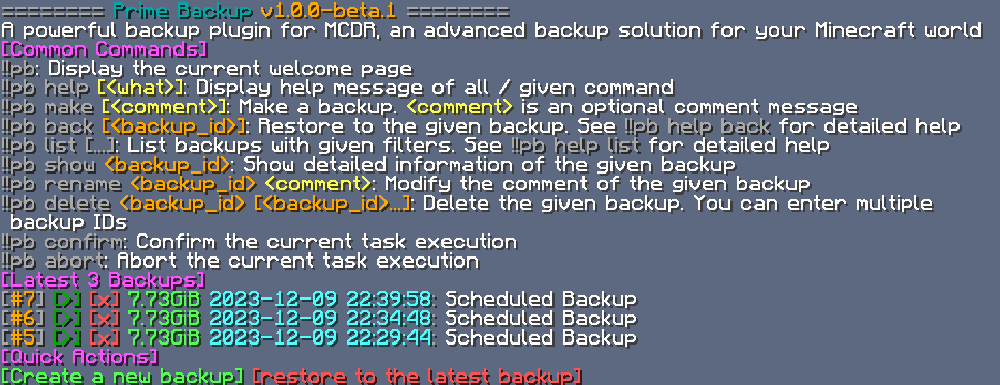

# Prime Backup

English | [中文](README.zh.md)

A powerful backup plugin for MCDR — an advanced backup solution for your Minecraft worlds

Documentation: https://tisunion.github.io/PrimeBackup/

## Features

- Hash-based, compressed file pool deduplication: only new or changed data is stored, with no hard limit on backup count
- Optional file chunking (Fixed-Size, Content-Defined Chunking, etc.): splits large files into chunks and deduplicates them by hash for higher storage efficiency
- Compact pack storage: stores compressed chunk data in pack files to avoid small-file overhead on the filesystem, with built-in validation and compaction
- Safe restore workflow: confirmation and countdown, automatic pre-restore backup, recycle-bin rollback on failure, and data integrity verification
- Comprehensive backup operations: create, restore, list, inspect, diff, import, and export backups
- Smooth in-game interaction: most common actions can be triggered directly with clicks in chat
- Rich database toolkit: overview, internal object inspection, integrity validation, orphan cleanup, file deletion inside backups, and hash/compression migration
- Highly customizable backup pruning policies inspired by [Proxmox Backup Server (PBS)](https://pbs.proxmox.com/docs/prune-simulator/)
- Scheduled jobs for automatic backup creation and pruning, supporting both fixed intervals and crontab expressions
- Standalone CLI tool for managing backups without MCDR, including mounting backups as a filesystem via FUSE

## Requirements

- [MCDReforged](https://github.com/Fallen-Breath/MCDReforged): `>=2.12.0`
- Python packages: see [requirements.txt](requirements.txt)
- Optional dependencies: see [requirements.optional.txt](requirements.optional.txt)

## Usage

See the documentation: https://tisunion.github.io/PrimeBackup/

## How It Works

Prime Backup stores backup data in a custom file pool where every stored object is identified by the hash of its content. Files with identical content are deduplicated and stored only once, significantly reducing disk usage. Stored data can also be compressed to save even more space

For large files that are modified locally, you can optionally enable file chunking. Each file is split into chunks and hashed individually. Unchanged chunks are reused across backups, while only new chunk data is compressed and appended to pack files

Prime Backup supports regular files, directories, and symbolic links:

- **Regular files**: Prime Backup computes the content hash and size
  - When chunking is enabled, the file is stored as a chunked blob referencing individual chunks; each chunk is deduplicated, compressed, and stored in pack files
  - Otherwise, the file is stored directly as a single deduplicated and compressed blob
  - File metadata (mode, uid, gid, mtime, etc.) is recorded in the database
- **Directories**: Stored as metadata entries in the database
- **Symbolic links**: The symlink target path itself is stored rather than the file it points to

## Acknowledgements

The hash-based file pool design was inspired by https://github.com/z0z0r4/better_backup
