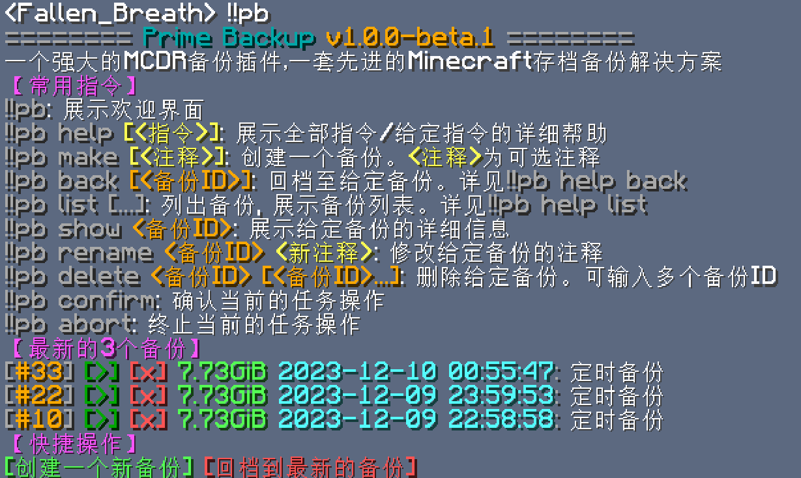

# Prime Backup

[English](README.md) | 中文

一个强大的 MCDR 备份插件，一套先进的 Minecraft 存档备份解决方案

中文文档：https://tisunion.github.io/PrimeBackup/zh/

## 功能特性

- 基于哈希去重与压缩的文件池：仅储存新增或变更的数据，备份数量没有硬性上限
- 可选的文件分块能力：支持固定大小分块（Fixed-Size Chunking）、内容定义分块（Content-Defined Chunking）等算法，将大文件切分为数据块并逐块去重，进一步节省空间
- 紧凑的打包存储机制：将压缩后的数据块集中写入打包文件，避免大量小文件给文件系统带来压力，同时支持完整性校验与空间整理
- 安全的回档流程：提供二次确认与倒计时、回档前自动创建临时备份、回收站式失败回滚以及数据完整性校验
- 完善的备份操作：覆盖创建、回档、列表查看、差异对比、导入导出等全流程功能
- 流畅的游戏内交互，大部分操作都能点点点
- 丰富的数据库工具集：支持数据库概览、内部对象审查、完整性校验、孤立数据清理、删除备份内指定文件以及哈希/压缩算法迁移
- 高度可自定义的备份清理策略，是 [PBS](https://pbs.proxmox.com/docs/prune-simulator/) 所用策略的同款
- 定时任务：支持自动创建备份与自动清理备份，计划规则支持固定间隔和 crontab 表达式
- 独立命令行工具：无需启动 MCDR 即可离线管理备份，并支持通过 FUSE 将备份挂载为文件系统

## 依赖

- [MCDReforged](https://github.com/Fallen-Breath/MCDReforged)：`>=2.12.0`
- Python 依赖包：见 [requirements.txt](requirements.txt)
- 可选功能依赖：见 [requirements.optional.txt](requirements.optional.txt)

## 使用方法

参见文档：https://tisunion.github.io/PrimeBackup/zh/

## 工作原理

Prime Backup 使用自定义的文件池来储存备份数据，池中的每个数据对象都以其内容的哈希值作为唯一标识。内容完全相同的文件只会在磁盘上保存一份副本，配合可选的数据压缩，可显著降低存储空间占用

对于体积较大且常被局部修改的文件，Prime Backup 支持启用文件分块来提升去重效果。文件会被切分成多个数据块（Chunk）并分别计算哈希，未发生变化的数据块可在不同备份间直接复用，仅将新增数据块压缩后追加写入打包文件（Pack）

Prime Backup 支持常见文件系统类型，包括普通文件、目录和符号链接：

- **普通文件**：先计算文件内容哈希与大小
  - 启用分块时，文件作为分块数据对象储存，按数据块粒度独立去重、压缩并存入打包文件
  - 未启用分块时，文件作为直存数据对象，以整个文件为单位进行去重与压缩
  - 文件的权限（mode）、所有者（uid / gid）、修改时间（mtime）等元数据统一记录在数据库中
- **目录**：将其路径与元数据记录在数据库中
- **符号链接**：仅记录符号链接本身及其指向路径，不展开目标文件

## 致谢

基于哈希的文件池思路受 https://github.com/z0z0r4/better_backup 启发
