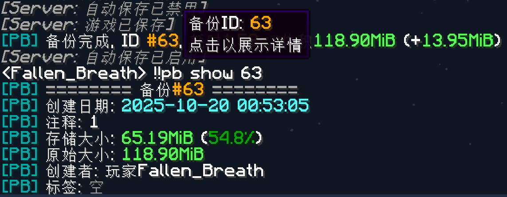

创建一个备份

## 备份步骤

### MCDR 环境

在 MCDR 环境中创建一个备份，只需执行如下命令：

```
!!pb make
```

就这样，非常简单的一条命令，即可创建一个备份

示例控制台输出：

```
> !!pb make
[MCDR] [00:46:11] [PB@51f5-worker-heavy/INFO] [prime_backup]: [PB] 创建备份中...请稍等
[Server] [00:46:11] [Server thread/INFO]: Automatic saving is now disabled
[Server] [00:46:11] [Server thread/INFO]: Saving the game (this may take a moment!)
[Server] [00:46:11] [Server thread/INFO]: ThreadedAnvilChunkStorage (world15): All chunks are saved
[Server] [00:46:11] [Server thread/INFO]: ThreadedAnvilChunkStorage (DIM-1): All chunks are saved
[Server] [00:46:11] [Server thread/INFO]: ThreadedAnvilChunkStorage (DIM1): All chunks are saved
[Server] [00:46:11] [Server thread/INFO]: Saved the game
[MCDR] [00:46:11] [PB@51f5-worker-heavy/INFO] [prime_backup]: Scanning file for backup creation at path 'server', targets: ['world']
[MCDR] [00:46:11] [PB@51f5-worker-heavy/INFO] [prime_backup]: Creating backup for ['world'] at path 'server', file cnt 4106, timestamp 1760892371872862, creator 'console:', comment '', tags {}
[MCDR] [00:46:12] [PB@51f5-worker-heavy/INFO] [prime_backup]: Create backup #59 done, +10 blobs (size 11.82MiB / 16.75MiB)
[MCDR] [00:46:12] [PB@51f5-worker-heavy/INFO] [prime_backup]: Time costs: save wait 0.1s, create backup 1.49s
[MCDR] [00:46:12] [PB@51f5-worker-heavy/INFO] [prime_backup]: [PB] 备份完成, ID #59, 耗时1.6s, 体积118.39MiB (+16.75MiB)
[Server] [00:46:12] [Server thread/INFO]: Automatic saving is now enabled
```

示例游戏内输出：


如需给备份带上个注释，便于后续查看备份时知道这个备份是做什么的，可以使用如下命令：

```
!!pb make <注释>
```

如：

```
!!pb make 香猪烤好了
```

在备份创建完后，可通过 `!!pb show` 或 `!!pb list` 命令来查看

具体操作步骤可参考[备份查看](backup_display.zh.md)文档



### 命令行环境

Prime Backup 也支持在命令行环境中执行核心的备份创建操作：

```
python3 PrimeBackup.pyz -d pb_files -c config/prime_backup/config.json make -s ./server "示例注释"
```

命令行 `make` 命令不会与 Minecraft 服务端交互，也不会关闭自动保存、发送保存命令或等待存盘完成。请在运行前自行保存或停止服务端


## 相关配置

创建备份相关的配置主要位于以下两节：

- [服务器配置](../config.zh.md#服务器配置)：控制创建备份时 Prime Backup 如何与 Minecraft 服务端交互
- [备份配置](../config.zh.md#备份配置)：控制备份目标、过滤规则、存储算法等核心选项

常用配置项：

| 选项                                                                              | 说明                                        |
|---------------------------------------------------------------------------------|-------------------------------------------|
| [server.turn_off_auto_save](../config.zh.md#turn_off_auto_save)                 | 创建备份期间是否临时关闭 Minecraft 的自动保存              |
| [backup.targets](../config.zh.md#targets)                                       | 指定需要备份的文件与目录                              |
| [backup.ignore_patterns](../config.zh.md#ignore_patterns)                       | 备份时忽略匹配的文件，回档时将其删除                        |
| [backup.retain_patterns](../config.zh.md#retain_patterns)                       | 备份时忽略匹配的文件，回档时保留不变                        |
| [backup.creation_skip_missing_file](../config.zh.md#creation_skip_missing_file) | 备份过程中跳过突然消失的文件                            |
| [backup.hash_method](../config.zh.md#hash_method)                               | 哈希算法。Prime Backup 会复用哈希相同的内容以节省存储空间       |
| [backup.compress_method](../config.zh.md#compress_method)                       | 储存备份数据时使用的压缩方法                            |
| [concurrency](../config.zh.md#concurrency)                                      | 最大并发数。根据机器配置适当调大可加快哈希计算速度                 |


!!! note

    建议在创建首个备份前就确定好 `hash_method` 和 `compress_method`。若已有备份，修改这两项时请注意：

    - `hash_method` 不可直接在配置文件中修改，否则会导致 Prime Backup 加载失败，必须通过 `!!pb database migrate_hash_method <算法>` 命令迁移
    - `compress_method` 可直接修改，但仅对新增数据生效；如需转换存量数据的压缩方法，请执行 `!!pb database migrate_compress_method <压缩方法>`


## 备份流程详解

Prime Backup 创建备份的完整流程如下：

1. 准备 Minecraft 服务端环境（以下步骤均可配置）
    1. 发送 `save-off` 等命令关闭自动保存
    2. 发送 `save-all flush` 等命令触发存档落盘
    3. 等待服务端输出 `Saved the game` 等存盘完成日志
2. 创建备份
    1. 扫描备份目标并排除忽略项，生成待备份文件列表及其元数据
    2. 若并发数配置大于 1，使用多线程预先计算文件哈希值
    3. 逐个处理待备份文件：
        1. 计算哈希值，若已预计算则直接复用
        2. 检查该内容是否已存在；若不存在，则将其作为直存数据对象写入，或在命中分块规则时切分并去重写入打包文件
        3. 将文件元数据与哈希记录写入数据库
    4. 生成本次备份的文件集，完成备份
3. 恢复 Minecraft 服务端状态
    1. 若第 1 步关闭了自动保存，在此重新开启
